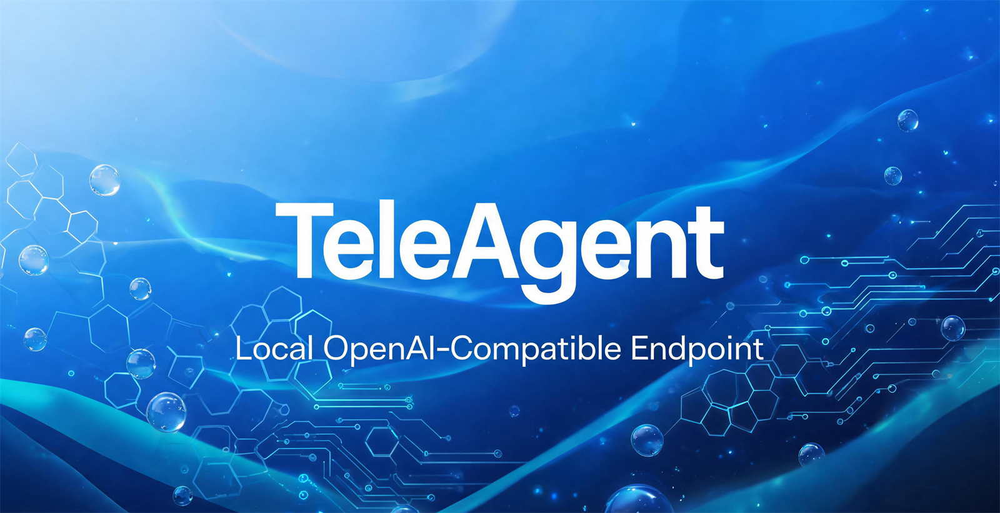

# TeleAgent 模型反代 —— 本地 OpenAI 兼容接口（两种方案）



> 封面图由 TeleAgent 自己的生图工具生成（`内部工具/生图`）。

把 **TeleAgent（电信 AI「超级智能体」桌面 App）** 的模型能力，在本机暴露成**标准 OpenAI 兼容接口**（`http://127.0.0.1:8788/v1`），让 pi / Cline / Cursor / 任何 OpenAI 客户端 / 脚本都能调用它的模型（`chat-pro` / `chat-lite` / `chat-flash`）。

本仓库给出**两种实现方案**，请按需选择：

| | 方案 A：直连云网关 | 方案 B：走 App 本地 server |
|---|---|---|
| 链路 | shim → **云网关** `agent.teleai.com.cn` | shim → **App 本地 server** `127.0.0.1:4397` → 云网关 |
| 出站流量特征 | 与 App **不同**（服务端可见"第二客户端"） | 与 App **完全一致**（由 App 进程发出） |
| 需要自己算云签名 | ✅ 需要（两轮 HMAC） | ❌ 不需要（App 自己算） |
| 需要 App 开着 | ❌ 不需要（token 有效期内可独立跑） | ✅ 必须开着 |
| 需要读 App 内存 | ❌ | ✅（取本地会话密钥） |
| 被封风险 | **较高** | **低**（但仍非零） |
| **工具调用** | ✅ **支持**（网关原生 OpenAI，可传自定义 tools） | ❌ **不支持自定义工具**（内核用它自带的工具集） |
| 实现状态 | **已实现**（`scripts/teleagent-shim.js`） | **已实现**（`scripts/teleagent-local-shim.js`） |

> ⚠️ **合规与风险**：把 App 内额度搬到 App 外使用，违反服务商条款。**已有账号因本方法被封（`40109 current user is banned`）的真实案例**，详见 [`docs/ban-risk.md`](docs/ban-risk.md)。请仅在你自己的机器、自己的账号上研究，**风险自担**。想零风险请直接用官方 App。

---

## 目录

- [0. 快速开始（老手看这段就够）](#0-快速开始老手看这段就够)
- [1. 原理总览](#1-原理总览)
- [2. 方案 A：直连云网关](#2-方案-a直连云网关)
- [3. 方案 B：走 App 本地 server](#3-方案-b走-app-本地-server)
- [4. 接入 pi](#4-接入-pi)
- [5. 接入其它工具](#5-接入其它工具)
- [6. 关于 API Key](#6-关于-api-key)
- [7. 二次使用 / 一键恢复](#7-二次使用--一键恢复)
- [8. 迁移到别人的环境](#8-迁移到别人的环境)
- [9. 排错](#9-排错)
- [10. 文档索引](#10-文档索引)

---

## 0. 快速开始（老手看这段就够）

```bash
# 一次性：解出 safeStorage 的 AES key -> token.key
scripts\setup.cmd

# 每次开机：启动本地接口（127.0.0.1:8788）
scripts\start-shim.cmd

# 验证
curl http://127.0.0.1:8788/v1/models
```

然后在客户端里填：
```
Base URL : http://127.0.0.1:8788/v1
API Key  : teleagent          （本地不校验，随便填；见 §6）
Model    : chat-pro | chat-lite | chat-flash
```

---

## 1. 原理总览

TeleAgent 的模型端点**本身就是 OpenAI 兼容**的，只在外面套了一层私有鉴权（登录令牌 + HMAC 签名）。反代的核心就是**补上这层鉴权**。

### 方案 A（直连）
```
你的工具 (pi/Cline/脚本)
   │  OpenAI 协议: POST /v1/chat/completions
   ▼
本地 shim (127.0.0.1:8788)              ← scripts/teleagent-shim.js
   │  ① 从 token.json 解出登录令牌 X-Token（AES-256-GCM）
   │  ② 生成 ts(秒)+nonce(UUID)，算两轮 HMAC 签名
   │  ③ 带全部网关鉴权头，直连
   ▼
https://agent.teleai.com.cn/superCowork/sapi/api/v1/chat/completions
   ▼ SSE 原样透传回客户端
```

### 方案 B（走 App 本地 server）
```
你的工具
   │
   ▼
本地 shim (127.0.0.1:8788)
   │  带 X-SA-Signature（本地签名）+ X-Auth-Token(或等价头)
   ▼
App 本地 server (127.0.0.1:4397)   ← 由 TeleAgent 进程自带(Go/hertz)
   │  它持有登录态，自己算云签名、自己发请求
   ▼
云网关  ← 服务端只看到「App 在正常使用」
```
**方案 B 的关键优势**：出站请求由 **TeleAgent 本体进程**发出，指纹/心跳/会话节奏与真人用 App 完全一致，服务端无法区分"是不是 App 在用"。

两套签名算法细节见 [`docs/signature-algorithms.md`](docs/signature-algorithms.md)。

---

## 2. 方案 A：直连云网关

### 2.1 前置条件
- TeleAgent 已安装并**已登录**过（存在有效 `token.json`）。
- TeleAgent 自带运行时：`%USERPROFILE%\.local\share\TeleAgent\runtimes\{node,python}\`。
- 无需管理员权限，无需第三方依赖。

### 2.2 一次性初始化
双击 `scripts\setup.cmd`（内部用 TeleAgent 自带 Python 跑 `setup.py`）：
```
[+] AES key 已写入 token.key
    key = <64位hex>
```
它做的事：读 `…\TeleAgent\Local State` 的 `os_crypt.encrypted_key`（Electron safeStorage **v10**）→ 去掉 `DPAPI` 5 字节 → Windows DPAPI `CryptUnprotectData` → 32 字节 AES key → 写入 `token.key`。

### 2.3 启动
```
scripts\start-shim.cmd
```
自检：
```bash
curl http://127.0.0.1:8788/v1/models
# {"object":"list","data":[{"id":"chat-pro"},{...}]}

curl http://127.0.0.1:8788/v1/chat/completions -H "Content-Type: application/json" \
  -d '{"model":"chat-pro","messages":[{"role":"user","content":"Say OK"}],"max_tokens":200}'
# choices[0].message.content 有内容 = 成功
```

### 2.4 请求头形状（shim 自动生成）
```
POST /superCowork/sapi/api/v1/chat/completions
Authorization: Bearer sk-xxxxxxxx            # 通道密钥(内嵌固定)
X-Route-Target: ops-gateway
X-Token: <tenant>:<JWT>                      # 登录令牌
X-App-Version: 2.5.0
X-Device-Os / X-Device-Os-Version
X-Superagent-Device-Id / Install-Id
X-Superagent-Timestamp: <10位秒>
X-Superagent-Nonce: <UUID>
X-Superagent-Sign-Version: v1
X-Superagent-Signature: <64位hex>
X-Teleai-Client-Type: desktop / X-Teleai-Run-Unit-Type: agent_loop
User-Agent: super-agent/1.0
```

### 2.5 注意事项
- **不要**用错误签名反复试探网关 —— 会触发风控（`40105 疑似攻击` → `40109 封号`）。这是本仓库作者踩过的坑。
- `token.json` 有效期约 3~4 天，shim 会在 401/403 时自动重新解密；token 彻底过期需重开 App 登录。

---

## 3. 方案 B：走 App 本地 server

> ✅ **已实现可用**：`scripts/teleagent-local-shim.js`。
> ⚠️ **重要限制：不支持自定义工具调用**（内核用它自己固定的工具集，会忽略请求里的 `tools`）。
> 需要工具调用（如 pi 做编码）请用[方案 A](#2-方案-a直连云网关)，或见 [§3.6 工具限制](#36-工具调用限制重要)。

### 3.0 快速使用

```bash
# 一次性 / 每次开机：从 TeleAgent 进程取本地会话密钥
teleagent\runtimes\python\python.exe scripts\get-session-key.py

# 启动方案 B shim（可双击）
scripts\start-local-shim.cmd

# 自检
curl http://127.0.0.1:8788/v1/models
```

然后客户端照常填 `http://127.0.0.1:8788/v1`（与方案 A 同一端口，**pi 配置无需改动**）。

前置：**TeleAgent 必须正在运行并已登录**。

### 3.1 原理
TeleAgent 进程内跑着一个**本地 HTTP server**（Go 写的 `hertz` 框架），监听 `127.0.0.1:4397`（另有 `:19876`）。它是 App 前端（Electron 渲染进程）与内核通信的桥：
- 它**自己持有登录态**，会**自己**用云签名去调网关；
- 前端给它发请求时要带**本地签名** `X-SA-Signature`（防其它程序乱调）。

所以：**我们只要冒充 App 前端，往 `127.0.0.1:4397` 发本地请求，出站就完全由 App 发出。**

### 3.2 需要什么
1. **本地会话密钥 `sessionKey`**（32 字节）
   - App 启动时由前端 `randomBytes(32)` 生成，通过**子进程环境变量** `SUPER_AGENT_LOCAL_SESSION_KEY` 传给内核；每次启动都变。
   - 获取办法（二选一）：
     - **(a) 读内核进程内存**：搜 `SUPER_AGENT_LOCAL_SESSION_KEY` 或直接定位 AUTH_STATE 解密密钥（需要先解出 AUTH_STATE 结构，见下）。
     - **(b) 读前端进程内存/日志**：Electron 渲染进程里持有同一密钥。
2. **本地签名算法**（已逆向，见 [`docs/signature-algorithms.md`](docs/signature-algorithms.md#2-本地-signature-app本地server)）：
   ```
   X-SA-Signature = base64url( HMAC-SHA256( sessionKey,
        ["local-v1", METHOD, pathWithQuery, Date.now()ms, <12字节hex随机>].join("\n") ) )
   ```
   > 注意：第 4 项是**毫秒**，第 5 项是**12 字节随机数的 hex**。
3. **AUTH_STATE**（App 自己维护的登录态密文）：
   ```
   AUTH_STATE = AES-256-GCM( SHA256(sessionKey), {token, deviceId, installId} )
   ```
   用它可验证你拿到的 sessionKey 是否正确。

### 3.3 本仓库的实现（`scripts/teleagent-local-shim.js`）

它做的事：
1. 从同目录 `session.key` 读 `sessionKey`（没有就读 `TA_SESSION_KEY`；失效时自动重跑 `get-session-key.py`）。
2. 把 OpenAI 请求翻译成内核接口：
   ```
   POST /v1/chat/completions
     └─→ POST http://127.0.0.1:4397/session              # 每个会话建一个内核会话
         POST http://127.0.0.1:4397/session/:id/message  # 发消息，拿 parts
   ```
   出站请求带本地签名：
   ```js
   const ts  = Date.now();                                 // 毫秒!
   const rnd = crypto.randomBytes(12).toString('hex');
   const msg = ['local-v1', method, '/session', ts, rnd].join('\n');
   const sig = crypto.createHmac('sha256', sessionKey).update(msg).digest('base64url');
   // X-SA-Sign-Version / X-SA-Timestamp / X-SA-Nonce / X-SA-Signature
   ```
3. **会话映射**：OpenAI 请求没有会话 ID。shim 用「历史消息前缀的 SHA1」把多轮对话绑到同一个内核会话：
   每轮结束后记录 `hash(本轮全部消息) -> 内核会话ID`，下一轮（历史 = 上轮全量）就能命中同一个会话。
   （也可以把多个内核会话完全独立，代价是丢失上文。）
4. **响应转换**：内核返回的 `data.parts` 里 `type=="text"` 的部分拼成 `choices[0].message.content`；
   `stream:true` 时把这段文本按块模拟成 SSE（内核接口本身是一次性返回）。
5. **空响应兜底**：刚建会话时偶发空回复，会自动重发一次。

### 3.4 内核接口速查（OpenCode 风格）

| 方法 | 路径 | 说明 |
|---|---|---|
| GET | `/session` | 列出会话 |
| POST | `/session` | 建会话，body `{"title":"..."}`，返回 `{id}` |
| POST | `/session/:id/message` | 发消息。body `{model:{providerID,modelID}, parts:[{type:"text",text:"..."}], system?}`，返回 `{data:{info,parts}}` |
| GET | `/session/:id/message` | 取该会话消息列表 |
| GET | `/provider` | 列 provider（可见 `NewApi` → 网关 baseURL + apiKey） |
| GET | `/config` | 内核配置（`agent` / `mcp` / `provider`） |
| GET | `/openapi` | 路由摘要 |
| GET | `/global/event` | SSE 事件流 |

模型选择：`{"providerID":"NewApi","modelID":"chat-pro"}`。

### 3.5 优缺点
- ✅ 出站流量与 App 无异 → **被封风险最低**。
- ✅ 不用自己维护云签名算法（App 升级也不影响）。
- ✅ 已实现，pi 配置与方案 A 完全相同（同一端口）。
- ❌ **不支持自定义工具调用**（见下）。
- ❌ App 必须开着；`sessionKey` 每次启动会变，需重新获取（脚本已自动化）。
- ❌ 账号已被封时无用（App 自己也 401）。

### 3.6 工具调用限制（重要）

内核跑的是 **它自己的 agent 循环**，工具集是固定的（bash / 读写文件 / online_search / MCP 等，由内核配置决定）。
实测：在 `/session/:id/message` 里传 OpenAI 风格的 `tools` 定义会被忽略，模型会直接回答“工具列表里没有 xxx”。

所以：
- 只想**对话** → 方案 B 完全够用，且最安全。
- 需要**自定义工具调用**（pi 做编码、跑代理循环）→ 只能用方案 A（直连网关，网关是真正的 OpenAI 端点、原生支持 tools）。
- 桥接思路：内核支持在 `/config` 里配 **MCP server**，理论上可把外部工具注册给内核（但那样跑的是内核的 agent 循环，不是调用方的）。

---

## 4. 接入 pi

pi 的自定义 provider 配在 `%USERPROFILE%\.pi\agent\models.json`，key 在 `%USERPROFILE%\.pi\agent\auth.json`。

**`models.json`**（在已有 `providers` 里**追加** `teleagent`，勿删原有）：
```json
{
  "providers": {
    "teleagent": {
      "baseUrl": "http://127.0.0.1:8788/v1",
      "api": "openai-completions",
      "apiKey": "teleagent",
      "compat": { "supportsStore": false, "supportsDeveloperRole": false, "maxTokensField": "max_tokens" },
      "models": [
        { "id": "chat-pro",   "name": "TeleAgent chat-pro",   "reasoning": true, "input": ["text"],
          "contextWindow": 200000, "maxTokens": 65536, "cost": {"input":0,"output":0,"cacheRead":0,"cacheWrite":0} },
        { "id": "chat-lite",  "name": "TeleAgent chat-lite",  "input": ["text"],
          "contextWindow": 200000, "maxTokens": 65536, "cost": {"input":0,"output":0,"cacheRead":0,"cacheWrite":0} },
        { "id": "chat-flash", "name": "TeleAgent chat-flash", "input": ["text"],
          "contextWindow": 200000, "maxTokens": 65536, "cost": {"input":0,"output":0,"cacheRead":0,"cacheWrite":0} }
      ]
    }
  }
}
```

**`auth.json`**：
```json
{ "teleagent": { "type": "api_key", "key": "teleagent" } }
```

使用：pi 里输入 `/model` → 选 `teleagent` → 选 `chat-pro`（改完即热重载，无需重启）。

---

## 5. 接入其它工具

| 字段 | 值 |
|---|---|
| Base URL / API Base | `http://127.0.0.1:8788/v1` |
| API Key | 任意（如 `teleagent`） |
| Model | `chat-pro` / `chat-lite` / `chat-flash` |

```python
from openai import OpenAI
c = OpenAI(base_url="http://127.0.0.1:8788/v1", api_key="teleagent")
print(c.chat.completions.create(model="chat-pro",
      messages=[{"role":"user","content":"你好"}]).choices[0].message.content)
```

---

## 6. 关于 API Key

**默认 shim 不校验本地客户端传来的 key** —— 它只在**出站**时补真鉴权。所以这个 key **只是占位符，填什么都行**（本文档统一用 `teleagent`）。

去哪儿看：它就是你**自己填进客户端**的那个值：
- pi：`%USERPROFILE%\.pi\agent\auth.json` 的 `teleagent.key`
- pi：`%USERPROFILE%\.pi\agent\models.json` 的 `providers.teleagent.apiKey`

```powershell
type $env:USERPROFILE\.pi\agent\auth.json
```

**想设真 key**（防本机其它程序误用）：
```powershell
setx TA_API_KEY "my-secret-123"     # 永久；重启 shim 生效
```
之后客户端必须带这个 key，否则 401；再把 pi 配置里的 `teleagent` 换成它。
（shim 只监听 `127.0.0.1`，外网访问不到，此步非必须。）

---

## 7. 二次使用 / 一键恢复

重启电脑后：
1. 确认 **TeleAgent 已打开并登录**（方案 B 必须；方案 A 只要 token 没过期可不开）。
2. 双击启动脚本：
   - **方案 B（推荐，最安全）**：`scripts\start-local-shim.cmd`（会先自动取本地会话密钥）
   - 方案 A（支持工具调用）：`scripts\start-shim.cmd`

两个方案都监听**同一个端口 8788**，所以**客户端/pi 配置无需改动**，换着跑即可。

**不需要再跑 setup**（`token.key` 一直在，除非换机器/重装系统）。

**开机自启（可选）**：把 `start-shim.cmd` 的快捷方式放进 `shell:startup`，或建「登录时运行」的计划任务。

**常用检查**：
```powershell
netstat -ano | findstr :8788                                   # 在跑吗
"%USERPROFILE%\.local\share\TeleAgent\runtimes\node\node.exe" teleagent-shim.js   # 前台跑看日志
```

---

## 8. 迁移到别人的环境

拷贝 `scripts/` 到对方机器 →

1. 对方装好 TeleAgent 并登录；
2. 双击 `setup.cmd`（生成**对方自己的** `token.key`）；
3. 双击 `start-shim.cmd`；
4. 按 §4 配置对方的 pi。

**已自动探测、无需手改**：账号目录 `users/v1_public_*`、`deviceId`/`installId`（读 `app-auth/device-meta.json`）、`token.json` 路径、Node/Python 路径。

**可用环境变量覆盖**：

| 变量 | 作用 | 默认 |
|---|---|---|
| `TA_PORT` | shim 监听端口 | `8788` |
| `TA_AES_KEY` | 直接提供 AES key（不读 token.key） | 读 `token.key` |
| `TA_DATA_DIR` | TeleAgent 数据目录 | `%USERPROFILE%\.local\share\TeleAgent` |
| `TA_ACCOUNT` | 账号分区目录名 | 自动取 `users/v1_public_*` 第一个 |
| `TA_DEVICE_ID` / `TA_INSTALL_ID` | 覆盖设备号 | 读 `device-meta.json` |
| `TA_APP_VERSION` | `X-App-Version` | `2.5.0` |
| `TA_SK` | 通道密钥 | 内嵌默认值 |

---

## 9. 排错

| 现象 | 原因 / 解决 |
|---|---|
| `500 缺少 AES key` | 没跑 `setup.cmd`，或 `token.key` 不在预期位置。跑一次 setup。 |
| `500 找不到账号目录` | TeleAgent 没登录过。先打开 App 登录。 |
| `401 40101 缺少安全头` / `40104` | 签名参数变了（多半 App 升级）。按 [`docs/signature-algorithms.md`](docs/signature-algorithms.md) 用真机抓包重校。 |
| `401 40103` | 系统时间不准（签名用 10 位**秒**）。校准时间。 |
| `401 40105 疑似攻击` | 风控。**立即停止**，别再刷。 |
| `401 40109 current user is banned` | **账号被封**。见 [`docs/ban-risk.md`](docs/ban-risk.md)。 |
| `403 40301 版本过低` | `X-App-Version` 太旧，改 `TA_APP_VERSION`。 |
| pi 里看不到 teleagent | `models.json` JSON 写错，或没在 `auth.json` 加 `teleagent`。改完重开 `/model`。 |
| pi 能选但连不上 | shim 没在跑。双击 `start-shim.cmd`。 |
| 工具调用不生效 | 网关原生支持 tools（已实测）；确认请求确实带了 `tools`。 |

---

## 10. 文档索引

| 文件 | 内容 |
|---|---|
| [`docs/signature-algorithms.md`](docs/signature-algorithms.md) | **两套签名算法**（云网关两轮 HMAC + App 本地 `X-SA-Signature`）逐字段说明 |
| [`docs/ban-risk.md`](docs/ban-risk.md) | 封号机理、触发因素、规避建议（含真实案例时间线） |
| [`docs/recon-notes.md`](docs/recon-notes.md) | 逆向过程笔记：二进制地址、内存扫描方法、错误码表 |
| `scripts/teleagent-shim.js` | **方案 A** 实现（直连网关，自动探测 account/device/install，支持工具调用） |
| `scripts/setup.py` / `setup.cmd` | 一次性：解出 AES key |
| `scripts/start-shim.cmd` | 启动方案 A |
| `scripts/teleagent-local-shim.js` | **方案 B** 实现（走 App 本地 server） |
| `scripts/get-session-key.py` | 从 TeleAgent 进程内存取本地会话密钥 → `session.key` |
| `scripts/start-local-shim.cmd` | 启动方案 B（含取密钥） |
| `docs/signature-algorithms.md` | 两套签名算法 |
| `docs/ban-risk.md` | 封号机理与真实案例 |
| `docs/recon-notes.md` | 逆向过程与工具方法 |

---

**一句话**：装一次（`setup.cmd`）→ 之后开机双击（`start-shim.cmd`）→ 客户端填 `http://127.0.0.1:8788/v1`。
**想更安全**：用方案 B（走 App 本地 server），出站流量与 App 一致。
